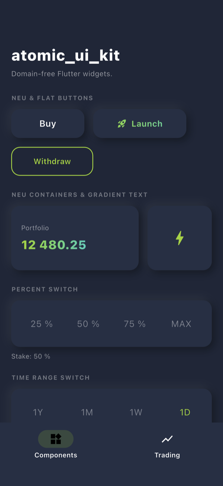

# atomic_ui_kit

A small kit of domain-free Flutter widgets: neumorphic buttons and containers,
gradient text, switches, badges, and more. The widgets use only Flutter and
`decimal`. They do not know about app models, state management, or platform
plugins.

## Widgets

| Widget | Description |
| --- | --- |
| `NeuButton` | Neumorphic button with an ink splash and an optional gradient. |
| `NeuContainer` | Neumorphic container that paints the neu shadows. |
| `NeumorphicCard` | Neumorphic card with padding around its child. |
| `NeumorphicProgress` | Linear progress bar with the neu shadows. |
| `NeuTheme` | `ThemeExtension` with the shared neu shadows, background color, and radius. |
| `AtomicTheme` | `ThemeExtension` with the base color, shadow colors, depth, and radius. |
| `AppFlatButton` | Flat button with an ink splash and an optional border. |
| `GradientText` | Paints text with a `Gradient` through a `ShaderMask`. |
| `Indicator` | Colored shape followed by a bold label. |
| `DropdownMenuIcon` | Button that opens an overlay menu and reports the selected item. |
| `AnimatedListItem` | List item that scales and tilts into place on the first build. |
| `PercentSwitch` | Row of 25 %, 50 %, 75 %, and MAX options. |
| `TimeRangeSwitch` | Row of 1Y, 1M, 1W, and 1D options. |
| `PriceBadge` | Price change badge: green for a positive change, red for a negative change. |
| `slideUpRoute` | `Route` that slides a page up from the bottom of the screen. |

## Install

```bash
flutter pub add atomic_ui_kit
```

## Usage

Register `NeuTheme` on the ambient `ThemeData` to restyle every neu widget in
the subtree. Then use `NeuButton`:

```dart
MaterialApp(
  theme: ThemeData(
    extensions: const [
      NeuTheme(
        keyBackgroundColor: Color(0xFF252F45),
        borderRadius: 12,
      ),
    ],
  ),
  home: Center(
    child: NeuButton(
      height: 56,
      width: 200,
      onTap: () {},
      child: const Text('Buy'),
    ),
  ),
);
```

`PercentSwitch` reports 0.25, 0.5, 0.75, or 1.0. `TimeRangeSwitch` reports
`TimeRangeSwitchValue.day`, `.week`, `.month`, or `.year`:

```dart
PercentSwitch(
  onChanged: (percent) {
    // 0.25, 0.5, 0.75 or 1.0
  },
);

TimeRangeSwitch(
  onChanged: (range) {
    // TimeRangeSwitchValue.day, .week, .month or .year
  },
);
```

## Theming

`AtomicTheme` carries the shared values of the kit: the base color, the light
and dark shadow colors, the depth, and the radius. Register it on the ambient
`ThemeData`:

```dart
MaterialApp(
  theme: ThemeData(
    extensions: const [
      AtomicTheme(
        baseColor: Color(0xFF252F45),
        depth: 2,
        radius: 12,
      ),
    ],
  ),
  home: const NeumorphicCard(child: Text('Themed card')),
);
```

The neumorphic widgets resolve each value in this order: the explicit widget
argument, the `NeuTheme` extension, the `AtomicTheme` extension, and the
built-in defaults. The built-in defaults reproduce the original look of the
package.

`depth` is the shadow offset, and the blur radius is `depth * 4`. The default
depth of `1` reproduces the original shadows exactly. `AtomicTheme.of(context)`
returns the registered extension, or the default values when the app registers
none.

## NeumorphicCard

`NeumorphicCard` paints the neu shadows behind a rounded surface and pads its
child:

```dart
NeumorphicCard(
  padding: EdgeInsets.all(20),
  child: Text('Card content'),
);
```

The card reads the ambient theme by default. Pass `color`, `radius`, `shadows`,
or `depth` to override a value.

## NeumorphicProgress

`NeumorphicProgress` shows a fraction between `0.0` and `1.0` as a linear bar:

```dart
NeumorphicProgress(
  value: 0.6,
  height: 14,
  color: Colors.green,
);
```

The bar paints the neu shadows by default and reads the theme. `color` sets
the filled part and `trackColor` sets the track. The bar announces its
percentage value to assistive technologies.

## Platforms

`atomic_ui_kit` is pure Flutter with no native code and no platform plugins.
It runs on Android, iOS, web, macOS, Windows, and Linux.

## Example

A runnable app in [`example/`](example/) shows the widgets. It has a
components gallery and a trading dashboard.

## Screenshots

<p>
  
</p>
